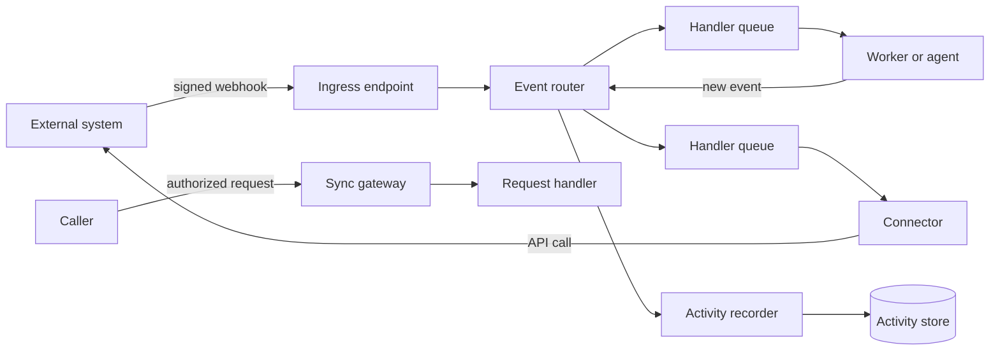

> [!WARNING]
> **Status: draft specification.** Nothing here has been built yet. This README describes the platform as designed, as if it already existed. The design lives in [`ai/specs/`](ai/specs).

# Event Bus

**One platform for connecting external systems, internal services, AI agents, and people through events. You write the logic; the bus provides the plumbing, the audit trail, and the observability.**

## The problems it solves

| Without it | With the event bus |
| --- | --- |
| **Every integration reinvents the plumbing.** Each new webhook gets its own listener, signature check, retry loop, and duplicate handling, each written slightly differently. | All webhooks enter through one front door that verifies, de-duplicates, and traces them. Every handler gets its own queue and dead-letter queue, generated from a short declaration. A shared library handles acknowledgment, retries, and tracing. |
| **Failures disappear.** A dropped webhook or an exhausted retry is found days later, if anyone notices at all. | A message is acknowledged only after its work succeeds. A final failure is published as an event, dead-lettered, and alerted on. Rejected webhooks are recorded too. |
| **Traces stop at the queue.** You can't follow a request from the webhook to the API call it eventually caused. | One continuous trace runs from the webhook, through every queue and handler, to the outbound call. Every log line links to its trace. |
| **"What happened to PR 42?" means digging through logs.** | Every event is recorded in a queryable activity store, by entity and time. The control plane shows it in a web app, an API, and an MCP server. |
| **Credentials end up everywhere.** Any service that needs to touch GitHub ends up holding a write token. | Only a system's connector holds a credential that can change it. Everything else reads with read-only credentials. Secrets are scoped per component. |
| **Coordinators become a second source of truth.** Workflow engines and state machines hold their own copy of process state. | Handlers react to events and publish what they did. State lives in the systems that own it, such as the issue tracker or the git host. |
| **Background jobs "succeed" when they start.** A container that launches and then crashes looks the same as one that worked. | Sandboxed tasks are acknowledged only when they finish. If no completion arrives in time, the task counts as failed and is retried. |
| **AI agents are bolted on.** They come with their own framework and UI, no audit trail, unknown cost, write access to main, and questions asked in a chat window nobody watches. | Agents are ordinary handlers, so they get the same queues, traces, audit trail, and failure handling. Inference cost is metered and concurrency is capped. Agents propose changes as branches and pull requests, and ask people questions where those people already work. |

## How it works



- **Asynchronous path for changes.** Events (in CloudEvents format) are routed to every handler that subscribes to them.
- **Synchronous path for reads.** An authorized gateway sends quick requests to request handlers.
- **Handlers run however their work needs:** as queue-triggered functions, durable workflows, request handlers, sandboxed tasks (a full Linux environment per message), or unmanaged consumers that pull from the queue themselves. The delivery guarantees are the same in every case.

## Adding a handler

To add a handler, you declare what it listens to and how it runs, then write its logic. The bus generates the routing rule, queue, dead-letter queue, and access policies from the declaration. (The YAML below is illustrative.)

```yaml
name: ticket-review
owner: platform-team
filters:
  - source: [issues]
    type: [issues.issue.labeled]
    data: { label: [review] }
queue:
  visibilityTimeoutSeconds: 300
  maxAttempts: 5
execution:
  class: queue-function
```

You don't have to write it by hand. The bus includes an **AI skill for creating handlers**. It picks the right handler types and execution classes for a task, writes the definitions, and implements them following the handler contract, with telemetry built in.

## AI agents and people

The agent platform builds on the bus without adding plumbing of its own:

- **Agents are handlers.** Short reasoning runs as a function. Multi-step work runs as a durable workflow. Code changes run as a sandboxed task with a headless coding agent, using the same skills and MCP tools that developers use.
- **Agents propose and people decide.** Agents push only to working branches, and their comments go through connectors.
- **Questions go where people already work:** issue comments before code exists, review comments on pull requests after. People outside those tools answer in a separate interview app. Each reply is a new event, and agents keep no conversation state of their own.
- **Agents are fully observable.** Agent spans, token and cost metrics, and session logs are all linked to the trace that triggered them.

## Runs on AWS or Cloudflare

The roles and the delivery guarantees are the same on both platforms. Where a platform lacks a capability, the bus adds the missing plumbing instead of weakening the guarantees. For example, it adds a router and a replay tool on Cloudflare, and a task dispatcher on both. Everything is defined as code.

## Documentation

| Document | Covers |
| --- | --- |
| [Event bus specification](ai/specs/event-bus/platform-event-bus-spec.md) | Roles, contracts, and the guarantees every handler can rely on |
| [AWS profile](ai/specs/event-bus/platform-event-bus-profile-aws.md), [Cloudflare profile](ai/specs/event-bus/platform-event-bus-profile-cloudflare.md) | How each role is filled on each platform |
| [Integration profiles](ai/specs/event-bus/platform-event-bus-integration-profiles.md) | Compatible external services by category |
| [Agent platform specification](ai/specs/agent/agent-platform-spec.md) | Agents, questions, and the interview app |
| [Agent platform AWS profile](ai/specs/agent/agent-platform-profile-aws.md), [Cloudflare profile](ai/specs/agent/agent-platform-profile-cloudflare.md) | Agent roles on each platform |
| [Implementation slices](ai/specs/slices) | The build plan: button demo, PR reviewer assignment, workflows and sandboxed tasks, issue impact-analysis agent, remaining components |
